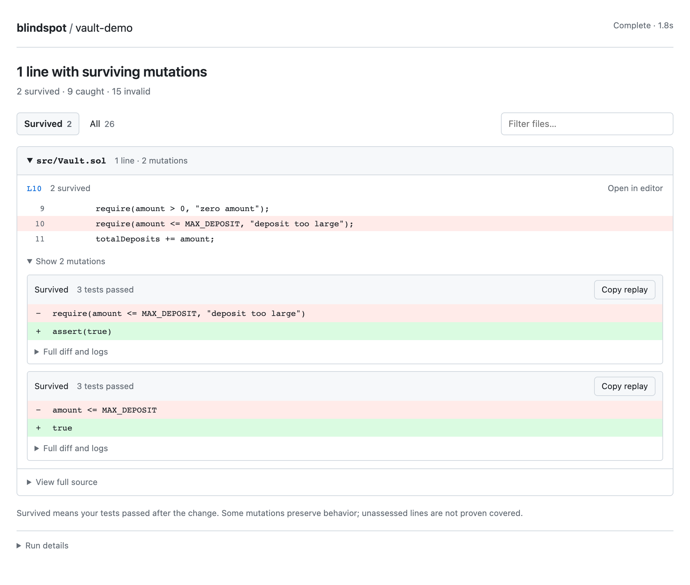
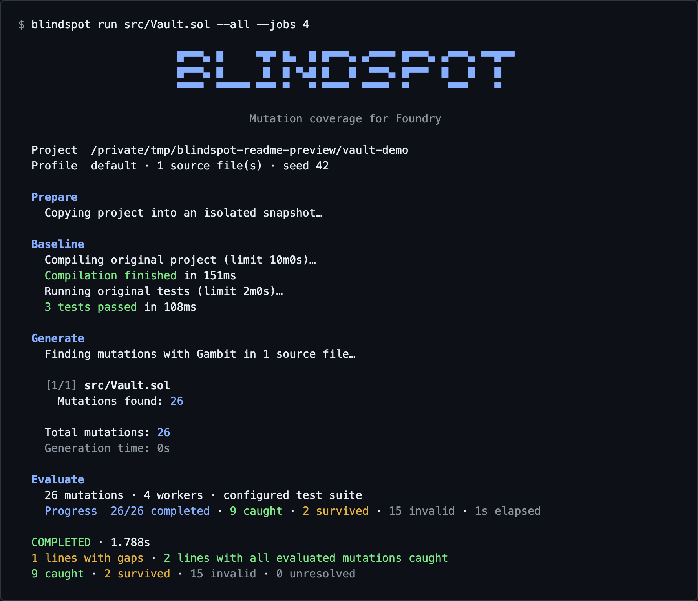

# Blindspot

Find gaps in your Foundry tests with [Certora Gambit](https://github.com/Certora/gambit).

Blindspot changes your Solidity code one mutation at a time in separate project copies, runs your existing tests, and shows which changes went undetected in a local browser report. It does not generate or fix tests.

## Preview

A run against a small demo contract: all three tests pass, but removing the deposit-limit check goes undetected. The report highlights the affected line and shows the exact changes that survived.



<details>
<summary>See the terminal output from the same run</summary>

The terminal shows build and test progress, mutation counts, and the final results.



</details>

## Install

Requires **[Foundry](https://getfoundry.sh/)** (`forge` on your PATH). No Go installation is needed.

With Homebrew:

```sh
brew install kitanovicd/tap/blindspot
```

Or use the standalone installer:

```sh
curl -fsSL https://raw.githubusercontent.com/kitanovicd/blindspot/main/install.sh | sh
export PATH="$HOME/.local/bin:$PATH"
```

The standalone installer downloads a verified release to `~/.local/bin`. Add the `export` line to your shell configuration if that directory is not already on your PATH. Run the installer again to update, or use `brew update && brew upgrade blindspot` for Homebrew installations.

Supports **macOS (Apple Silicon and Intel)** and **Linux x86-64**, including WSL. Guided setup downloads and verifies Gambit v1.0.6 when needed. No account or hosted service is needed.

Prefer Go? Use `go install github.com/kitanovicd/blindspot@latest` with Go 1.23+, put Go's bin directory on your PATH, then run `blindspot setup`. [Manual downloads](https://github.com/kitanovicd/blindspot/releases/latest) and [installation options](docs/usage.md#installation-options) are also available.

## Run

Open the menu:

```sh
blindspot
```

Choose **Run mutation tests**, **Free up space**, or **Open a saved report**. Use the arrow keys and Enter to navigate.

Starting a run asks for your project path, dependency installation command, build command, and test command. Use Forge directly, a Makefile, or a script—for example, `make deps`, `make build`, and `make test`. Then choose the files, mutation limit, parallel workers, and whether to keep replay files. Reports are always kept.

Dependencies and the initial build run in your project, so a fresh clone works too. The baseline and each mutation use the same build and test commands in separate copies. Commands are saved locally and offered as defaults next time.

For an already prepared project, use flags directly:

```sh
blindspot run --project /path/to/project src/Vault.sol --limit 5 --open
```

For all mutations across the project:

```sh
blindspot run --project /path/to/project --all --open
```

Blindspot first checks that the baseline build and tests pass. It then compiles and runs the configured tests for each mutation. Project layout comes from `foundry.toml`; Forge wrappers should invoke `forge` through PATH. See [custom commands](docs/usage.md#guided-setup-and-custom-commands) for automation.

- Guided setup defaults to **all mutations**. Runs using flags default to **50 mutants** unless you pass `--limit` or `--all`.
- `--limit` is a maximum. If Gambit finds five mutations, `--limit 20` still evaluates five.
- `--all` removes the mutant limit, but timeouts still apply.
- Paths are relative to the project. Omit `--project` to use the current directory.

Each mutant needs a build and test run. Start small on large projects.

Guided setup asks how many workers to use and remembers your choice per project. The default is two workers (one on a single CPU). Use `--jobs 4` to evaluate up to four mutations in parallel; with `--interactive`, this skips the worker prompt and overrides the saved choice. More workers use more CPU and memory.

## Understand the report

| Result | Meaning |
| --- | --- |
| Survived | Tests passed despite the change. This may be a test gap. |
| Caught | Tests failed because of the change. |
| Invalid | The mutation did not compile. Excluded from evaluated coverage. |
| Unresolved | A timeout, runner error, or interruption prevented a result. |

The report groups surviving mutations by file and line. Expand a line to inspect the change, view logs, or copy a replay command.

**Mutation coverage is not line execution coverage.** Some surviving changes preserve behavior. Lines without evaluated mutations are unassessed, not proven covered.

## Reopen or replay

```sh
# Open the latest report without running tests
blindspot report --project /path/to/project

# Recheck one mutation from a saved run
blindspot replay MUTATION_ID --project /path/to/project --run RUN_ID
```

All runs, reports, snapshots, and settings are saved under **`~/.blindspot/`**. Set `BLINDSPOT_HOME` to use another dedicated folder. Snapshots and logs may contain local secrets; reports include source and paths, so review them before sharing.

Replay requires keeping the project snapshot and mutation files. Start a new run to evaluate changed code or tests.

## Saved reports and cleanup

```sh
blindspot reports                  # Choose a report with the arrow keys
blindspot clean                    # Review sizes and select files to remove
blindspot clean --all --yes         # Delete all inactive saved runs and reports
```

Cleanup keeps reports by default. Add `--project /path/to/project` to limit it to one project, or `--dry-run` to preview without deleting. Active projects are skipped. Project source files and setup settings are preserved.

The report browser and cleanup only read the Blindspot folder. They do not scan your home directory or need access to Desktop, Documents, or Downloads.

To move runs created by an older version from one specific project, use `blindspot import --project /path/to/project`. Old runs are never searched for automatically. See the [usage guide](docs/usage.md#browse-and-clean-saved-runs) for details.

See the **[usage guide](docs/usage.md)** for flags, timeouts, FFI, CI, exporting reports, and compatibility. Use `blindspot COMMAND --help` for command options.

## Contributing

All contributions are welcome. [Open an issue](https://github.com/kitanovicd/blindspot/issues) to report a bug or suggest an improvement, or [submit a pull request](https://github.com/kitanovicd/blindspot/pulls) to help improve the tool.

Blindspot is independent of Certora, Foundry, and Solidity. See [third-party notices](THIRD_PARTY_NOTICES.md) and [license](LICENSE).
